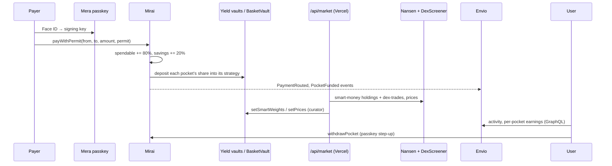
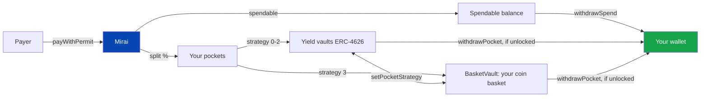

<p align="center">
  
</p>

<h1 align="center">Mirai</h1>

<p align="center">
  Get paid in digital dollars, and a slice of every payment saves itself. Split across up to ten pockets, each one earning yield or holding a basket of coins, on Monad.
</p>

<p align="center">
  <a href="https://github.com/maulana-tech/mirai-mon"></a>
  <a href="https://testnet.monadscan.com/address/0xEAFFa1705b5cf69B291aa88484F9655Fe8341b83"></a>
  <a href="https://www.agora.finance"></a>
  <a href="https://mera.category.xyz"></a>
  <a href="https://www.nansen.ai"></a>
  <a href="https://envio.dev"></a>
  <a href="https://data.chain.link"></a>
  <a href="#hackathon-submission"></a>
</p>

---

Mirai is a savings app for your own income on **Monad testnet**. You share one payment link; whoever pays you does it in **AUSD** with a single transaction, and the `Mirai` contract splits the payment on arrival: part stays spendable, part is saved (20% by default). The saved part is spread over **up to ten pockets** (a laptop, a trip, a rainy-day fund), each with its own share, target, lock and strategy: one of three ERC-4626 **yield vaults**, or a **coin basket** that follows **Nansen** smart money and is priced by **Chainlink**.

You sign in with a **passkey** (Face ID or fingerprint) through **Mera**. There is no seed phrase, no wallet extension and no faucet to visit: new accounts get gas and test AUSD automatically.

> **Mirai never holds your money in a server, and nobody but you can move it.**
>
> - Every user-scoped function takes the user explicitly and requires `msg.sender == user`. Savings sit in the contract, booked to **your** pockets
> - Withdrawing savings, closing a pocket and setting a lock always ask for the passkey again, even inside a signed-in session
> - Pocket names and targets are encrypted with a key derived from your passkey before they go on-chain. The chain only ever sees ciphertext

---

## Demo

Demo video and live URL: being prepared for the submission (see [SUBMISSION.md](SUBMISSION.md)). Until then, run it locally against the live testnet contracts in two commands: [Setup](#setup).

| # | Flow | Where |
|---|---|---|
| 1 | Sign in with a passkey, get test funds automatically | `/app` |
| 2 | Share your payment link and QR | `/app/link` |
| 3 | Pay a link from a second account: one passkey tap, one transaction | `/pay/:address` |
| 4 | Watch the split land in spendable money and pockets | `/app`, `/app/pockets` |
| 5 | Open a pocket: strategy, target, lock, withdraw, close | `/app/pockets/:id` |
| 6 | Invest: follow Smart Money, a preset, or your own mix | `/app/market` |
| 7 | Full history from the Envio indexer | `/app/activity` |

---

## What Makes Mirai Special

### Who This Is For

Meet Dimas, a freelance developer in Bandung. His clients are abroad and pay him a few times a month, never the same amount. He knows he should save, but every payment lands in one account, and by the time he thinks "I'll put some aside", it's gone.

He tried a fixed monthly auto-debit. It took the same amount in a dry month and left him short, so he switched it off. Stablecoin vaults pay more than his bank, but picking one, moving money there and keeping a seed phrase safe are three more chores he will never get to.

Dimas's problem is not a missing product. It is that **saving is a decision he has to make again for every payment**, at the worst possible moment.

---

### The Problem

- **Saving depends on willpower.** Money lands in one place and stays spendable until it is spent
- **One savings pot for every goal.** A laptop, a trip and an emergency fund mix together, so none of them feels real
- **Idle savings earn nothing.** Choosing vaults or coins is expert work, so most savings just sit
- **Getting paid from abroad is slow and costly,** and the money arrives in one lump that's easy to spend
- **Crypto onboarding scares people off.** Seed phrases, extensions and gas are a wall before the first payment

**How might we make saving happen by itself, on every payment, for people who don't think of themselves as crypto users?**

---

### The Solution

Mirai answers with five pieces, each doing a job the others can't.

**1. Savings at the payment layer.** `Mirai.payWithPermit()` pulls AUSD from the payer with an EIP-2612 permit and splits it in the same transaction, before anyone can spend it. No approve step, no transfer to remember.

**2. Pockets, one per goal.** Up to ten pockets share the saved slice by fixed percentages. Each has its own strategy, target and time lock, and can be closed into another pocket.

**3. Savings that grow, honestly labelled.** Three ERC-4626 yield vaults (simulated 4 / 8 / 12% APR on testnet), or an invest basket that follows Nansen smart money, a ready mix, or your own picks. The app says plainly when value can fall.

**4. One passkey, many keys (Mera).** The same passkey derives your signing key and, under a second PRF salt, a separate AES-256-GCM key that encrypts pocket names and targets on-chain.

**5. The blockchain stays out of sight.** Passkey sign-in, gas and test funds on signup, a 30-minute signing session, local-currency display, and three languages (English, Bahasa Indonesia, 中文).

---

## Pockets

The saved slice of every payment is spread over your pockets by fixed shares that sum to 100%.

| Property | How it works |
|---|---|
| **Up to 10 pockets** | Pocket 0 ("Main savings") always exists; open more with `createPocket` |
| **Share of new savings** | Whole percents, summing to 100% (`setPocketShares`). A change applies to future payments only |
| **Strategy per pocket** | Conservative, Balanced, Growth (yield vaults) or Invest (basket). Switching moves the pocket's money in one transaction (`setPocketStrategy`) |
| **Target** | Shown as a progress bar; stored encrypted with the name |
| **Time lock** | Extend-only (`setPocketLock`). Blocks withdrawals from that pocket until the date |
| **Private name and target** | Encrypted in the browser with your passkey-derived key; `setPocketMeta` stores only `version ‖ nonce ‖ ciphertext` |
| **Close** | Moves the pocket's money and share into another pocket (`closePocket`) |
| **Per-pocket earnings** | Envio tracks net deposits per pocket (`PocketFlow`), so the app shows what each pocket earned |

---

## Invest: Follow Smart Money (Nansen)

An invest pocket holds its own basket of coins in `BasketVault`: **USDC, BTC, ETH, LINK** (Chainlink push feeds on Monad) and **MON, CHOG, NADS, MONCAT, EMO** (curator prices from DexScreener's deepest pool). Each pocket picks one of:

- **Follow Smart Money** (default): weights set daily from Nansen, with guard rails: at least 10% stable, at most 50% in one coin, memecoins at most 10% each and 20% together. Followers move to new weights at today's prices without their value changing
- **A preset**: Blue chip (USDC 10 / BTC 45 / ETH 45) or Careful (USDC 60 / BTC 25 / ETH 15)
- **Your own mix**: any percentages. Above 20% memecoins the app asks for an explicit "I understand"

**How Nansen decides.** `web/api/market.ts` makes two Nansen calls a day (≈10 credits), both with `chains: ["monad"]`:

| Endpoint | What Mirai does with it |
|---|---|
| `POST /api/v1/smart-money/holdings` | Where smart money's money sits: USD held per token, holder count |
| `POST /api/v1/smart-money/dex-trades` | Where it is heading: net USD bought minus sold per token over 24h (`netflow` returns no rows for Monad yet, so the flow is computed from trades) |

Conviction per coin = USD held + 24h net buying (floored at 0). 90% is shared by conviction and clipped at the caps; what the caps cut goes to stable. When the result drifts more than 3% from the on-chain weights, the server (the basket's `curator`) calls `BasketVault.setSmartWeights`. **Nansen data moves followers' money; it isn't only displayed.** The Invest page shows, per coin, what smart money holds, what it bought today and the weight that came out.

---

## Features

- **Auto-split on every payment**: part spendable, part saved; 20% by default, your choice from 0 to 100%
- **Payment link and QR**: `/pay/:address` with an optional display name and preset amount; the payer sees how much goes straight to savings
- **One-transaction payments**: EIP-2612 permit + `payWithPermit`, no separate approve
- **Your own link, detected**: opening your own link offers to share it instead of paying yourself
- **Up to ten pockets**: fixed shares, own strategy, target, extend-only lock, close into another pocket
- **Private pocket names**: encrypted with a passkey-derived AES-256-GCM key, one prompt per session
- **Three yield vaults**: Conservative (4%), Balanced (8%, default) and Growth (12%) simulated APR on testnet, streamed every second
- **Invest basket**: follow Nansen smart money, a preset, or your own mix of nine coins
- **Invest page**: Chainlink prices on Monad, "Powered by Nansen" with today's update time, and a pool simulator (90-day backtest on Binance daily closes)
- **Yield projection**: the three strategies against saving with no yield, for your split, income and horizon
- **Passkey accounts (Mera)**: no seed phrase, no extension; the synced passkey restores the same account on any device
- **Signing session**: 30 minutes without prompts for everyday actions; step-up for withdrawing savings, closing pockets and locking
- **Automatic onboarding**: new accounts get gas and test AUSD from `/api/onboard`, no faucet visit
- **Send and withdraw**: spendable money any time; savings per pocket when unlocked
- **Activity history**: payments, pocket changes, withdrawals, from the Envio indexer
- **Local currency display**: balances in USD or your currency, with AUSD underneath
- **Three languages**: English, Bahasa Indonesia, 简体中文

---

## Tech Stack

| Layer | Technology |
|---|---|
| Contracts | Solidity 0.8.28, Foundry, OpenZeppelin v5 (41 tests, including a fork test against real AUSD) |
| Chain | Monad testnet (chain 10143) |
| Asset | AUSD (Agora), 6 decimals, EIP-2612 permit |
| Accounts | Mera passkeys (WebAuthn PRF → BIP-39 → secp256k1), AES-256-GCM via HKDF for private pocket data |
| Oracles | Chainlink USDC/USD, BTC/USD, ETH/USD, LINK/USD push feeds on Monad |
| Market data | Nansen Smart Money API, DexScreener (memecoin prices), Binance klines (simulator) |
| Indexer | Envio HyperIndex (GraphQL): activity, per-pocket deposits, saver and protocol totals |
| Frontend | React 19, Vite 8, TypeScript 6, Tailwind CSS v4, ethers v6, GSAP + Lenis, hairline line figures |
| Backend | Vercel Functions: `/api/onboard` (gas + test AUSD), `/api/market` (Nansen weights, curator prices) |
| Checks | `forge test`, oxlint, `tsc -b`, runnable scripts (`check-fork`, `check-pockets`, `check-market`, `check-pool`, `check-mera-signer`, `check-yield`) |

---

## Monad Integration

| Component | File | Description |
|---|---|---|
| **Mirai** | [`Mirai.sol`](evm/src/Mirai.sol) | Split on arrival, permit payments, pockets (shares, strategy, lock, encrypted meta, close), withdrawals |
| **Yield vaults** | [`MiraiVault.sol`](evm/src/MiraiVault.sol) | ERC-4626 AUSD vault per yield strategy, 10^6 virtual-share offset |
| **Testnet yield** | [`YieldStreamer.sol`](evm/src/YieldStreamer.sol) | Streams a fixed APR into a vault from a reserve; `Mirai` drips before every deposit and withdrawal |
| **Invest basket** | [`BasketVault.sol`](evm/src/BasketVault.sol) | A basket per (saver, pocket); Chainlink + curator prices; Smart Money or custom weights |
| **Frontend client** | [`mirai.evm.ts`](web/src/lib/mirai.evm.ts) | ABI, writes through the Mera signer, custom errors mapped to localized messages |
| **Signer** | [`mera-signer.ts`](web/src/lib/mera-signer.ts) | ethers signer over Mera; local nonce tracking and `estimateGas` + 10% (Monad charges the gas limit) |

| Monad property | How Mirai uses it |
|---|---|
| **Sub-second blocks** | A payment is split and saved before the confirmation screen loads; receipts are polled every 500 ms |
| **Gas charged on the limit** | Never a fixed gas limit: `estimateGas` + 10% |
| **Stale nonces right after a receipt** | `MeraSigner` tracks the next nonce locally, one signer per session |
| **100-block `eth_getLogs` cap** | Full history comes from Envio; without it the app falls back to ~5 minutes of RPC logs |

## Mera Integration

| Component | File | Description |
|---|---|---|
| **Wallet store** | [`wallet.tsx`](web/src/lib/wallet.tsx) | Passkey → PRF → BIP-39 → key → `MeraSigner`; 30-minute session; `getSigner({ stepUp })` for sensitive actions |
| **Private pocket data** | [`pocket-meta.ts`](web/src/lib/pocket-meta.ts) | Second PRF salt → HKDF → non-extractable AES-256-GCM key; encrypts name, icon and target |
| **Sign-in UI** | [`passkey-dialog.tsx`](web/src/components/passkey-dialog.tsx) | Create or restore an account; triggers `/api/onboard` for new ones |

## Chainlink Integration

| Feed | Address (Monad testnet) | Used by |
|---|---|---|
| USDC / USD | [`0x3982…Ff95`](https://testnet.monadscan.com/address/0x39820e7965e29DC86b94F20eD04e9c5cCf9aFf95) | BasketVault pricing, Invest page |
| BTC / USD | [`0x12C0…1715`](https://testnet.monadscan.com/address/0x12C0F44368a02081ce58a936d1C1F606BB301715) | BasketVault pricing, Invest page |
| ETH / USD | [`0x5c8c…6d31`](https://testnet.monadscan.com/address/0x5c8c8482f064049248F86D9F4aFa4B1f2F5b6d31) | BasketVault pricing, Invest page |
| LINK / USD | [`0x2A9F…b884`](https://testnet.monadscan.com/address/0x2A9FBFbf392594c4Dd7593C8a91cdEbc02e5b884) | BasketVault pricing, Invest page |

## Nansen and Envio Integration

| Component | File | Description |
|---|---|---|
| **Smart Money weights** | [`market.ts`](web/api/market.ts) | Nansen holdings + DEX trades → capped weights → `setSmartWeights`; DexScreener → `setPrices` |
| **Indexer config** | [`config.yaml`](indexer/config.yaml) | Mirai and BasketVault events on Monad testnet |
| **Schema** | [`schema.graphql`](indexer/schema.graphql) | `Activity`, `Saver`, `PocketFlow`, `Protocol` |
| **Handlers** | [`EventHandlers.ts`](indexer/src/EventHandlers.ts) | One activity row per event; per-pocket net deposits |
| **App reads** | [`activity.ts`](web/src/lib/activity.ts) | Activity feed, per-pocket flows, protocol stats over GraphQL |

---

## Architecture

### System Flow



### Where the money can go



Every path out of Mirai ends in the user's own wallet, and only the user can start it.

---

## Setup

### Requirements

- Node 22+ and npm
- [Foundry](https://getfoundry.sh) ≥ 1.8 (for the contracts)
- A passkey provider with WebAuthn PRF (iCloud Keychain, Google Password Manager, 1Password). On desktop Chrome, save the passkey to Google Password Manager
- For the indexer: Docker and an Envio API token

### Run locally

```bash
# Clone
git clone https://github.com/maulana-tech/mirai-mon.git
cd mirai-mon

# Contracts
cd evm && git submodule update --init && forge test && cd ..

# App against the live testnet deployment
cd web && npm install && npm run dev        # http://localhost:5173

# Indexer (optional: full history and earnings)
cd indexer && npm install && cp .env.example .env   # ENVIO_API_TOKEN, ENVIO_PG_PORT=5455
npx envio codegen && npx envio dev
```

An empty `VITE_MIRAI_ADDRESS` runs the UI on an in-memory mock (passkey sign-in still works on localhost). `npm run dev` also serves `/api/onboard` and `/api/market`, reading server env from `web/.env`.

### Scripts

```bash
npm run dev                         # Vite dev server
npm run build                       # tsc -b and vite build
npm run lint                        # oxlint
node scripts/check-fork.ts          # anvil fork end-to-end: pay → split → pockets → invest → withdraw
node scripts/check-pockets.ts       # pocket share math
node scripts/check-market.ts        # Smart Money weights from Nansen data
node scripts/check-pool.ts          # pool simulator
node scripts/check-mera-signer.ts   # signer equivalence with Mera
```

Full guides: [development](docs/development.md) and [deployment](docs/deployment.md).

> **Two traps worth knowing.** AUSD has **6 decimals**, and `web/src/lib/ausd.ts` and `formatMoney` assume it. And the strategy order (Conservative 0, Balanced 1, Growth 2, Invest 3) is shared by `Mirai.sol` and `web/src/lib/strategies.ts`: changing it in one place breaks the other.

---

## How It Works

### Saver Flow

```
Sign in with a passkey → Share your link → Every payment splits itself → Pockets fill → Savings grow
```

1. **Sign in**: Face ID or fingerprint; `/api/onboard` sends gas and test AUSD in the background
2. **Share**: your link or QR from `/app/link`, with an optional name and amount
3. **Get paid**: every payment lands split, spendable and saved
4. **Organise**: open pockets, set their shares, targets, strategies and locks
5. **Withdraw**: spendable money any time; a pocket's savings when it is unlocked

### Payer Flow

```
Open the link → Sign in with a passkey → Enter an amount → Pay (one transaction)
```

1. **Open** `/pay/:address`: the page shows how much of the payment goes to the recipient's savings
2. **Sign in** with a passkey (or create one; onboarding funds it on testnet)
3. **Pay**: an EIP-2612 permit is signed locally and `payWithPermit` sends it in one transaction

### Pocket Flow

```
New pocket → Name, icon, target (encrypted) → Strategy → Share of savings → Fill, lock, withdraw or close
```

1. **Create**: the name, icon and target are encrypted with your passkey key before `createPocket`
2. **Share**: set its percentage; the others are adjusted so the total stays 100%
3. **Strategy**: a yield vault or the invest basket; switch later in one transaction
4. **Lock**: extend-only, confirmed with the passkey
5. **Close**: its money and share move into another pocket

### On-Chain Flow

```
Payer            Mirai                         Yield vaults / BasketVault       Envio
  │                │                                  │                          │
  ├─ payWithPermit►│ permit → transferFrom            │                          │
  │                ├─ spendable (80%)                 │                          │
  │                ├─ each pocket's share ───────────►│ deposit(user, pocket)    │
  │                ├─ PaymentRouted, PocketFunded ────┼─────────────────────────►│
  │                │◄─ withdrawPocket (user, step-up) ┤                          │
  │◄── withdrawals only ever go to the user's own wallet                         │
```

---

## Contract Details

### Addresses (Monad testnet, chain 10143)

Deployed from block `68647993`; every contract below except AUSD is verified on Sourcify (exact match). Source of truth: [`deployments.json`](deployments.json) and [`web/src/lib/config.ts`](web/src/lib/config.ts).

| Contract | Address |
|---|---|
| Mirai | [`0xEAFFa1705b5cf69B291aa88484F9655Fe8341b83`](https://testnet.monadscan.com/address/0xEAFFa1705b5cf69B291aa88484F9655Fe8341b83) |
| BasketVault (invest) | [`0x4D7470dd92E1b58e48ccD4902B596A810F9189f6`](https://testnet.monadscan.com/address/0x4D7470dd92E1b58e48ccD4902B596A810F9189f6) |
| Conservative vault (4%) · streamer | [`0x6e18…e731`](https://testnet.monadscan.com/address/0x6e18fd1e7310DEBbaF42CbEDb8E67351d13ee731) · [`0xd119…B82B`](https://testnet.monadscan.com/address/0xd1195a8B1D9579CfcEDe2B3f819cbCf6B334B82B) |
| Balanced vault (8%, default) · streamer | [`0xb3d6…942e`](https://testnet.monadscan.com/address/0xb3d6Ba8127943C0F9Af129845C5EE7498c96942e) · [`0xdC6a…3D24`](https://testnet.monadscan.com/address/0xdC6aB7891A5F8E97F91Dd42B59D96D5D9f703D24) |
| Growth vault (12%) · streamer | [`0x7B0c…5394`](https://testnet.monadscan.com/address/0x7B0c991591C8dB9C983F48835aD4237068615394) · [`0x6F1C…3a4e`](https://testnet.monadscan.com/address/0x6F1C6f95F49196B5b8Cb769b16B9DE8C51f93a4e) |
| AUSD (Agora) | [`0xa9012a055bd4e0eDfF8Ce09f960291C09D5322dC`](https://testnet.monadscan.com/address/0xa9012a055bd4e0eDfF8Ce09f960291C09D5322dC) |
| Curator / drip wallet | [`0x59cC2ACdf03BD622428de6520A647afaF7382d98`](https://testnet.monadscan.com/address/0x59cC2ACdf03BD622428de6520A647afaF7382d98) |

### Key Functions

#### Mirai: payments and balances

```
pay(from, to, amount)                                  # split on arrival: spendable + pockets
payWithPermit(from, to, amount, deadline, v, r, s)     # the same, with an EIP-2612 permit (one transaction)
setSplit(user, bps)                                    # your savings split, 0–10,000 bps
withdrawSpend(user, amount)                            # spendable money back to your wallet
accountOf(user)  ·  pocketsOf(user)  ·  strategies()   # views
```

#### Mirai: pockets

```
createPocket(user, strategy, meta)        # up to 10; meta = encrypted name, icon, target
setPocketShares(user, bps[])              # shares of new savings, summing to 10,000
setPocketStrategy(user, id, strategy)     # moves the pocket's money to the new strategy
setPocketMeta(user, id, meta)             # re-encrypted label
setPocketLock(user, id, until)            # extend-only time lock
withdrawPocket(user, id, amount)  ·  withdrawAllPocket(user, id)   # when unlocked
closePocket(user, id, into)               # money and share move into another pocket
```

#### BasketVault

```
setWeights(user, pocket, weights[])       # your own mix, or empty = follow Smart Money
setSmartWeights(weights[])                # curator: daily weights from Nansen
setPrices(ids[], prices[])                # curator: prices for coins without a Chainlink feed
valueOf(user, pocket)  ·  prices()        # views
```

#### Events (indexed by Envio)

```
PaymentRouted · PocketFunded · SplitSet · SpendWithdrawn
PocketCreated · PocketSharesSet · PocketStrategySet · PocketLockSet · PocketMetaSet · PocketWithdrawn · PocketClosed
WeightsSet · SmartWeightsSet · PricesSet · Deposited · Withdrawn          # BasketVault
```

---

## Deployment Checklist

- [x] Mirai, three yield vaults + streamers and BasketVault deployed on Monad testnet, all verified on Sourcify (exact match)
- [x] Payments with EIP-2612 permit: one transaction, split on arrival
- [x] Pockets: up to ten, shares, strategy, target, extend-only lock, close
- [x] Private pocket names and targets, encrypted with a second passkey-derived key
- [x] Mera passkey accounts with a 30-minute session and passkey step-up for sensitive actions
- [x] Automatic onboarding: gas and test AUSD for new accounts
- [x] Invest basket: Chainlink prices, Smart Money weights from Nansen, presets and custom mixes
- [x] Envio HyperIndex: activity, per-pocket deposits, saver and protocol totals
- [x] Foundry tests (41) and a fork end-to-end check (`check-fork.ts`)
- [x] Landing page, three languages
- [ ] Live demo on Vercel and the indexer on Envio Cloud
- [ ] Demo video

**One limitation worth naming.** Yield vaults pay a simulated APR from a reserve, and the invest basket books units at oracle prices instead of swapping, because Monad testnet has no AUSD liquidity for these coins. The path to real money (real AUSD vaults, swaps through Kuru or 0x, a multisig curator, gas sponsorship) is written up in [docs/next-plan.md](docs/next-plan.md).

---

## Hackathon Submission

| | |
|---|---|
| **Event** | Monad Metropolis |
| **Track** | Consumer Products & Payments |
| **Bounties** | Mera UX · Mera One Passkey Many Keys · Agora (AUSD) · Nansen · Envio |
| **Network** | Monad testnet (chain 10143) |
| **Source** | [github.com/maulana-tech/mirai-mon](https://github.com/maulana-tech/mirai-mon) |
| **Details** | [SUBMISSION.md](SUBMISSION.md): what each bounty asked for and where it lives in the code |

### Why it fits Consumer Products & Payments

- **A real consumer job.** Saving from your own income, done at the moment money arrives, not a crypto tool looking for users
- **Payments first.** A shareable link, one-transaction permit payments, and the split happens inside the payment
- **Crypto kept out of sight.** Passkeys instead of seed phrases, automatic gas, local currency, three languages
- **Safe by construction.** Only the user can move their money, sensitive actions need the passkey again, and private data is encrypted before it reaches the chain

---

## Documentation

| Doc | What's in it |
|---|---|
| [Submission](SUBMISSION.md) | Track and bounty fit, with file references, demo script |
| [Architecture](docs/architecture.md) | Contracts, passkey accounts, data flow |
| [Deployment](docs/deployment.md) | Contracts, indexer, app; environment variables; smoke test |
| [Development](docs/development.md) | Local setup, checks, gotchas |
| [Next plan](docs/next-plan.md) | From testnet demo to mainnet with real money |

---

## License

MIT

---

> Every payment saves a little. Every pocket has a purpose. Mirai
