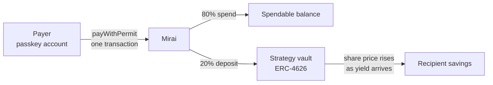

<div align="center">
  
  <h1>Mirai</h1>
  <p>Get paid in digital dollars. A slice of every payment saves itself and earns yield, on Monad.</p>

  
  
  
</div>

---

## What is Mirai?

Mirai splits every payment you receive into two pockets in the same transaction: a spendable balance, and savings that go straight into an ERC-4626 yield vault. Saving happens before you have a chance to spend, with no transfers to remember.

It is built for people who don't think of themselves as crypto users. You sign in with a passkey (Face ID or fingerprint), there is no seed phrase or wallet extension, and new accounts are funded with gas automatically, so the blockchain stays out of sight.

## How it works



1. **Sign in with a passkey.** [Mera](https://mera.category.xyz) derives the account key from the passkey's PRF output; a signing session keeps every later signature prompt-free. Clearing storage or switching device restores the same account from the synced passkey.
2. **Get paid.** Share `/pay/:address`. The payer signs an EIP-2612 permit locally and sends one `payWithPermit` transaction, so there is no separate approve.
3. **Auto-split.** The contract applies the recipient's split (default 20%) and deposits the savings slice into the vault in the same transaction.
4. **Earn and withdraw.** Savings are vault shares whose value rises as yield arrives. Spendable money can be withdrawn any time; savings can be time-locked toward a goal.

## Built on Monad

| | Why it matters here |
|---|---|
| **~300ms blocks, sub-second finality** | A payment is split and saved before the confirmation screen loads. The UI polls receipts every 500ms instead of ethers' 4s default. |
| **AUSD (Agora)** | A fully backed, 6-decimal USD stablecoin with EIP-2612 permit, so approve + pay is a single transaction. |
| **Mera passkey accounts** | The whole account layer: no extension, no seed phrase, no custody backend. |
| **Gas charged on the limit** | Gas limits come from `estimateGas` + 10%, never fixed padding, so users don't overpay. |
| **100-block `eth_getLogs` cap** | Full activity history comes from an [Envio](https://envio.dev) HyperIndex indexer (`indexer/`); the app falls back to the last ~5 minutes of RPC logs. |

## Yield: strategies, honestly

Savers pick one of four strategies, each its own ERC-4626 vault: three earn yield, one invests. Switching moves existing savings in one transaction.

| Strategy | Testnet APR | Mainnet market it stands in for |
|---|---|---|
| Conservative | 4% | Aave V3 · AUSD |
| Balanced (default) | 8% | Curvance · AUSD (~8% live) |
| Growth | 12% | Upshift · earnAUSD |
| Smart Money | market price, can go down | BTC/ETH swaps through Kuru |

**How it earns:** yield is AUSD added to a vault without minting shares, so the share price and every saver's balance rise together. On testnet there is no AUSD lending market, so a `YieldStreamer` per vault pays the strategy's APR from an AUSD reserve. `Mirai` calls `drip()` before every deposit and withdrawal (wrapped in `try/catch`), so nobody buys shares at a stale price and a broken streamer can never block a payment. The app labels these rates as simulated.

**On mainnet** the streamers go away: `Mirai`'s constructor takes any ERC-4626 vaults, so it can point straight at real AUSD markets.

## Smart Money: invest, powered by Nansen

The fourth strategy puts savings into a **BTC/ETH basket** instead of a yield vault. `MarketVault` is an ERC-4626 vault whose share value is the basket's market value, read from **Chainlink push feeds** on Monad (BTC/USD, ETH/USD), so it moves with the market and can fall below what was saved. The app shows that risk on every surface.

**Nansen decides the tilt.** `web/api/market.ts` calls Nansen's `POST /api/v1/smart-money/holdings` (`chains: ["monad"]`, stablecoins excluded, native tokens included) once a day:

- Smart money's USD holdings of BTC-like (WBTC, cbBTC, …) and ETH-like (WETH, wstETH, …) tokens set the basket weights, with a 20% floor per coin.
- When the weights drift more than 3% from the on-chain ones, the server (the vault's `curator`) calls `MarketVault.rebalance`, which re-weights at current prices without changing the value.
- The Yield page shows the basket, live prices and Nansen's top smart-money holdings on Monad (value, holders, 24h change), so the saver sees *why* the basket looks the way it does.

The **Market** page (`/app/market`) puts it in context: live prices from Chainlink on Monad, the Smart Money basket with a one-tap "invest" switch, and a pool simulator for any mix of crypto, tokenized stocks, gold and AUSD (90-day backtest on Binance daily closes, plus an 80% range from volatility). Only the Smart Money basket is investable on-chain; the simulator is labelled as a simulation.

On testnet there is no AUSD liquidity for BTC/ETH, so a deposit "buys" basket units at the Chainlink price and the vault's AUSD backs withdrawals. Gains above the AUSD held are capped until the operator tops up a reserve; losses stay in the vault. On mainnet `_buy`/`_sell` become swaps through Kuru and the vault holds the coins. AUSD sent to the vault does not move its share price, because value comes from basket units.

The Yield page also has a **projection** that compares the three yield strategies against saving with no yield, for the saver's own split and a chosen monthly income and time horizon.

## Passkeys done properly (Mera)

**Mera is the whole account layer.** No seed phrase, no extension, no custody backend.

| What judges test | How Mirai handles it |
|---|---|
| Time to first transaction | One passkey ceremony creates the account; `/api/onboard` funds gas and test AUSD in the background, so the first payment needs no faucet visit. |
| Session design | A Mera signing session makes everyday actions prompt-free for 30 minutes: paying, withdrawing spending money, changing the split, saving a goal. **Withdrawing savings and setting a time lock always ask for the passkey again** (step-up), even inside a session. The header shows the session countdown and a lock-now button. |
| Session expiry | When the session ends the key is zeroed; balances stay visible, and the next action runs one passkey prompt that must derive the same address. |
| Stateless test | Clear storage or open a new device, tap *I already have an account*: the synced passkey re-derives the same account. |

**One passkey, many keys.** The account key comes from the PRF output under Mera's default salt. A **private savings goal** (name + target) is encrypted with a separate PRF namespace: Mera's secret vault draws a fresh random salt and derives an AES-256-GCM key via HKDF (`mera.v1.encrypt.secret`). Only the vault (salt, nonce, ciphertext) is stored on-chain (`Mirai.setGoal`). On another device the same synced passkey re-derives the key and opens it. Nothing secret is stored anywhere, and the goal key is unrelated to the signing key.

## Repository layout

```
├── evm/              # Contracts (Solidity 0.8.28, Foundry, OpenZeppelin v5)
│   ├── src/Mirai.sol        # Mirai: split, permit pay, withdrawals, time lock
│   ├── src/MiraiVault.sol   # ERC-4626 AUSD vault, one per yield strategy
│   ├── src/MarketVault.sol  # Smart Money: BTC/ETH basket vault priced by Chainlink
│   └── src/YieldStreamer.sol # testnet yield source: streams a fixed APR into a vault
├── web/              # App (React 19, Vite, ethers v6, Mera)
│   ├── api/onboard.ts      # Vercel function: gas + test AUSD for new accounts
│   ├── api/market.ts       # Vercel function: Nansen smart-money holdings → basket weights
│   └── scripts/            # Runnable checks (signer equivalence, fork end-to-end)
├── indexer/          # Envio HyperIndex: Activity feed + per-saver and protocol totals
├── docs/             # Architecture, deployment, development
└── deployments.json  # Deployed addresses
```

## Running locally

```bash
# Contracts
cd evm && git submodule update --init
forge test                                                          # unit tests
MONAD_RPC_URL=https://testnet-rpc.monad.xyz forge test --match-contract Fork   # against real AUSD

# App
cd web && npm install
npm run dev        # http://localhost:5173 against the live testnet contract, onboarding included
```

See [docs/development.md](docs/development.md) for the full setup and [docs/deployment.md](docs/deployment.md) to deploy.

## Documentation

| Doc | Description |
|---|---|
| [Architecture](docs/architecture.md) | Contracts, passkey accounts, data flow |
| [Deployment](docs/deployment.md) | Deploying contracts, indexer and app; environment variables |
| [Development](docs/development.md) | Local setup, checks, gotchas |

## License

MIT
